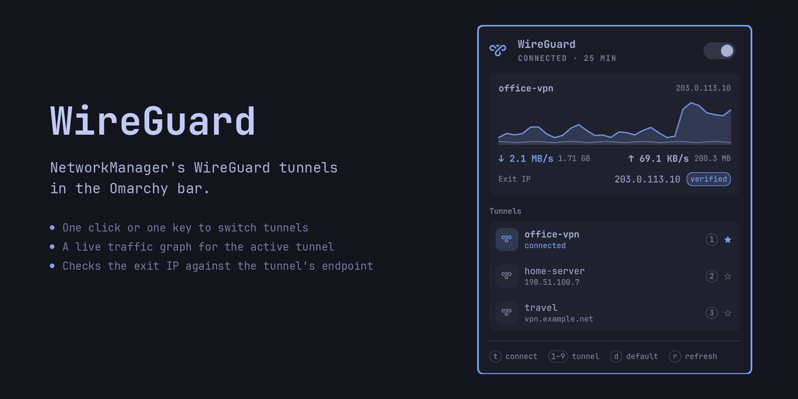

# Omarchy WireGuard

WireGuard tunnels for the [Omarchy](https://omarchy.org) bar: a status icon
with a panel that lists every WireGuard profile NetworkManager knows, switches
between them with one click, shows live transfer and verifies the exit IP.

Nothing to configure. Import a profile and it appears:

```bash
nmcli connection import type wireguard file my-gateway.conf
```

## Preview



## Features

- Every NetworkManager WireGuard profile, discovered automatically.
- One tunnel at a time (default): bringing one up takes the others down
  first, so two full-tunnel gateways never fight over the default route.
- A default tunnel for the power switch, the icon's right-click and the IPC
  `on` call. Star any row to choose it.
- A graph of the last minute of download and upload for the active tunnel,
  with the current rates and totals.
- Exit-IP check against the profile's peer endpoint: "verified" when the
  public address is the gateway, "unexpected" when it is not, "not checked"
  when the endpoint is a host name.
- A toast after every action: connect and switch report the exit IP (and
  flag a mismatch), disconnect and failures say so plainly. Can be turned off.
- Keyboard-driven panel and full IPC control.

## Installation

```bash
omarchy plugin add https://github.com/selfcrypto/omarchy-wireguard.git --enable
```

Verify:

```bash
omarchy plugin list
omarchy plugin validate ~/.config/omarchy/plugins/io.github.selfcrypto.wireguard
```

Update:

```bash
omarchy plugin update io.github.selfcrypto.wireguard
```

Remove:

```bash
omarchy plugin remove io.github.selfcrypto.wireguard
```

## Usage

- **Left-click** the bar icon: open the panel.
- **Right-click**: connect to the default tunnel, or disconnect.
- **Middle-click**: refresh.
- In the panel: click a row to switch to it (or disconnect it), click the
  star to make it the default. Keys: `t` toggle, `1`–`9` pick a tunnel
  (the default is always `1`), `d` make the connected tunnel the default,
  `r` refresh and re-check the exit IP.

## Configuration

Settings live on the widget's entry in `~/.config/omarchy/shell.json` and are
set with `omarchy bar set`:

```bash
omarchy bar set io.github.selfcrypto.wireguard defaultTunnel my-gateway
omarchy bar set io.github.selfcrypto.wireguard exclusive false --json
omarchy bar set io.github.selfcrypto.wireguard notifications false --json
omarchy bar set io.github.selfcrypto.wireguard refreshIntervalSec 5
```

| Key | Meaning | Default |
|---|---|---|
| `defaultTunnel` | NetworkManager connection name the switch / right-click / `on` bring up | first profile |
| `exclusive` | bring every other tunnel down before bringing one up | `true` |
| `notifications` | toast after every connect, switch, disconnect or failure | `true` |
| `refreshIntervalSec` | status poll interval, 2–60 s | `3` |

## IPC

```bash
omarchy-shell io.github.selfcrypto.wireguard status          # "gateway" or "disconnected"
omarchy-shell io.github.selfcrypto.wireguard list            # JSON: tunnels, active, default
omarchy-shell io.github.selfcrypto.wireguard on | off        # default tunnel up / everything down
omarchy-shell io.github.selfcrypto.wireguard up <name>
omarchy-shell io.github.selfcrypto.wireguard down <name>
omarchy-shell io.github.selfcrypto.wireguard setDefault <name>
omarchy-shell io.github.selfcrypto.wireguard toggle          # the panel
```

## Requirements and dependencies

- NetworkManager with WireGuard profiles (`nmcli`); `curl` for the exit-IP
  check; `sh` and `timeout` (coreutils). All ship with Omarchy.
- Runs entirely as the user: NetworkManager's default policy lets the active
  local session bring its connections up and down, so no polkit prompt.
- One external request: the exit IP comes from `https://1.1.1.1/cdn-cgi/trace`
  (Cloudflare), only while the panel is open or a tunnel changes.
- The exit-IP verdict is only given when the profile's endpoint is an IP
  literal; a hostname endpoint shows the address without a verdict.

## How it runs things

Every external command goes through `wg-helper.sh`, one process per
operation, as `timeout -k 3 <deadline> sh wg-helper.sh <command> args...`:

- **Deadlines.** Each operation has a wall-clock limit that covers its whole
  process group (`timeout` runs the helper as a group leader and signals the
  group, then kills it). Discovery 10 s, byte counters 5 s, exit IP 10 s, a
  switch 40 s plus 10 s per extra tunnel to bring down, toasts 15 s.
- **Fixed argv.** Tunnel names travel as arguments, never inside a script,
  and only names returned by the last discovery are passed on.
- **Bounded, validated output.** Discovery lists at most 32 profiles, clips
  names to 256 bytes and endpoints to 253, accepts interface names only when
  they satisfy the kernel's own rules (1–15 bytes, no `/`, `:` or whitespace)
  before touching `/sys/class/net`, and emits JSON. The widget re-validates
  every field it parses.
- **Exit IP.** HTTPS only, no redirects, 3 s connect and 6 s total deadline,
  4 KiB response cap in `curl` and again in the reader; the value is used
  only when the trace carries exactly one `ip=` line holding a canonical
  IPv4 address.
- **Text from outside** (names, endpoints, the exit IP) is rendered as plain
  text, capped and elided; IPC replies are bounded by the same limits.

## License

MIT. See [LICENSE](LICENSE).
